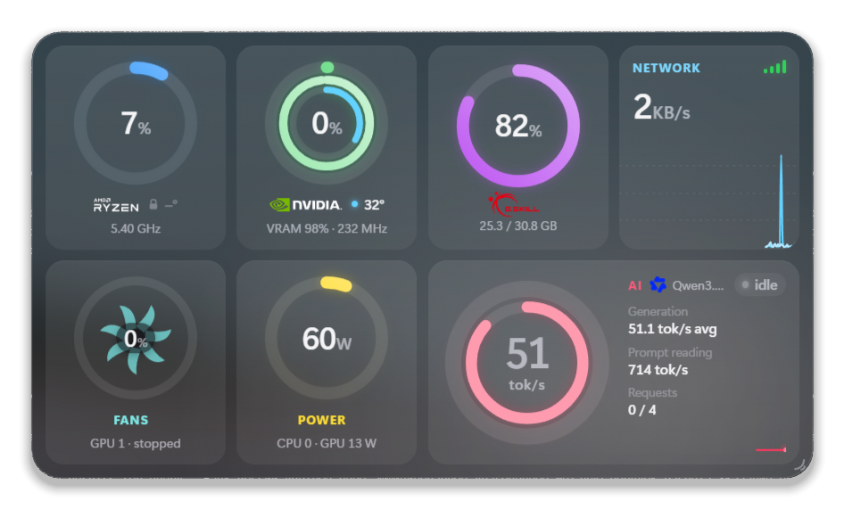
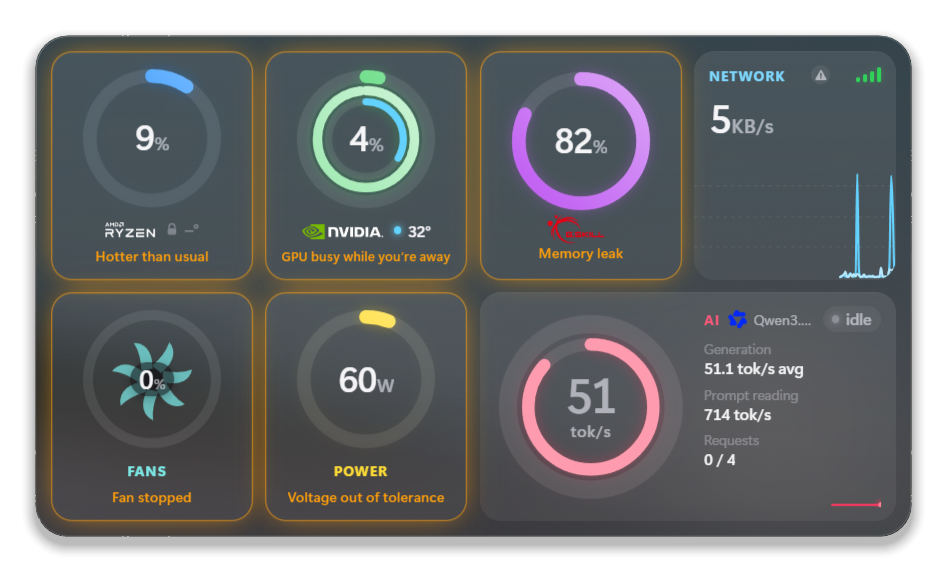
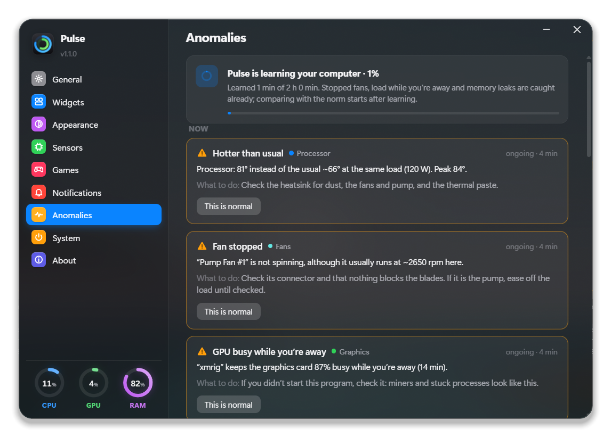
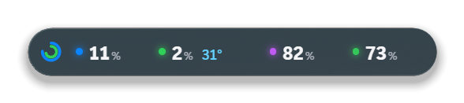
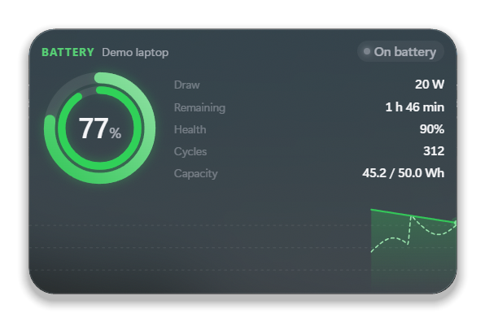
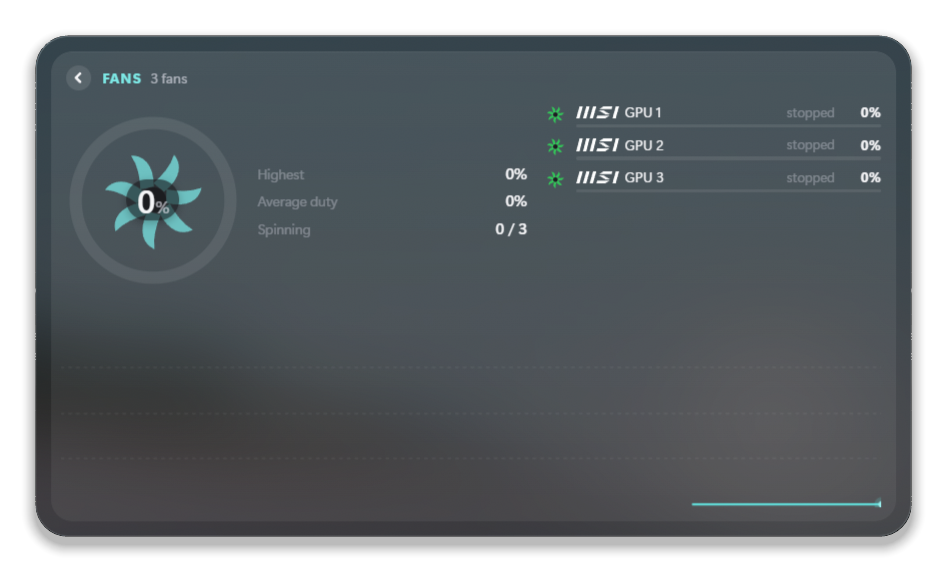
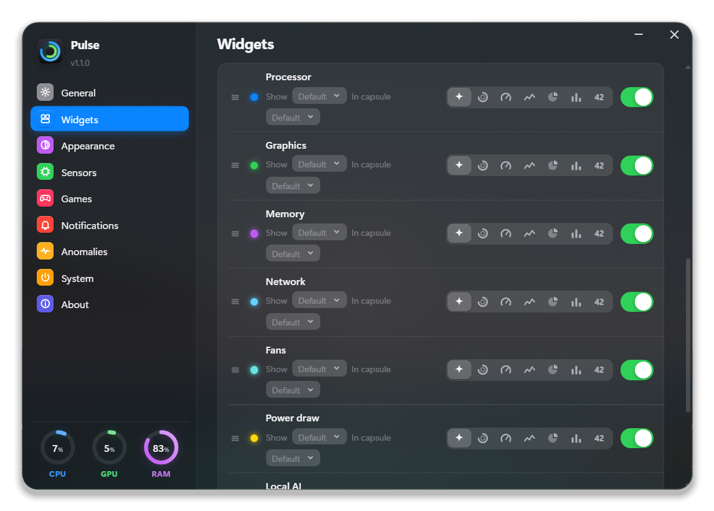
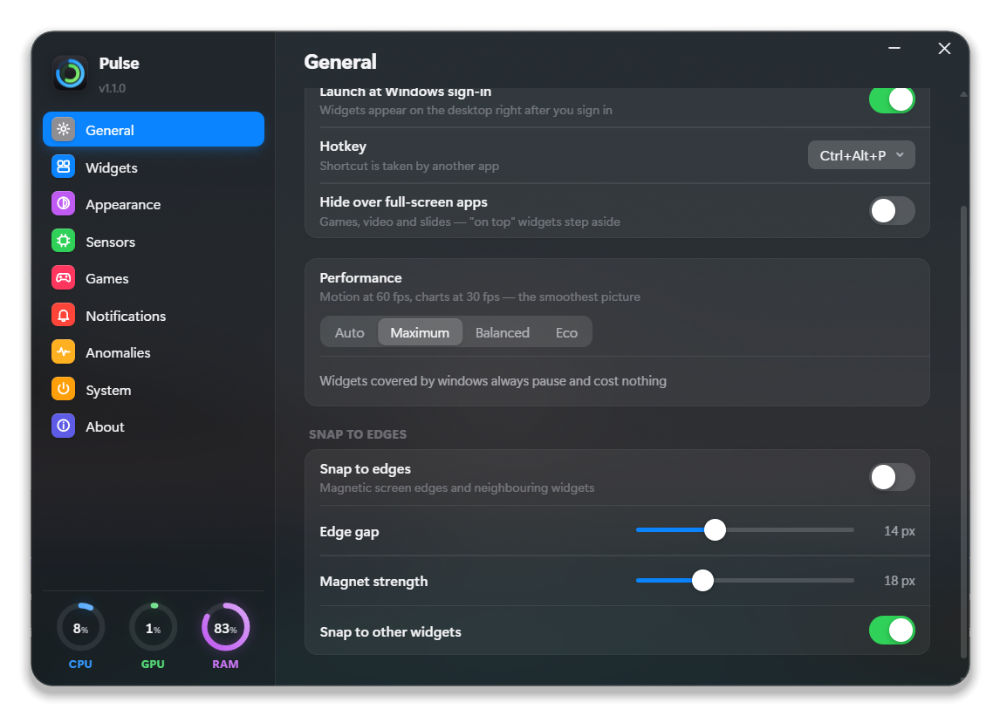
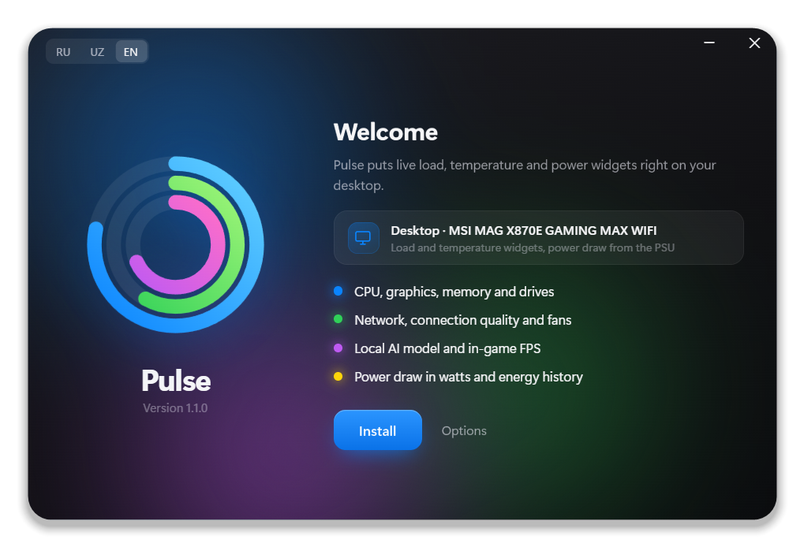

<p align="right"><a href="README.md">Русский</a> · <b>English</b></p>

# Pulse

**Live load, temperature and power widgets right on your Windows desktop.** Processor, graphics, memory, drives, network, fans, power supply, laptop battery, a local AI model and in-game FPS — in glass widgets with smooth, Apple-style motion.

<p align="center"></p>

<p align="center"><b><a href="../../releases/latest">⬇ Download the installer</a></b> · a single file, Windows 10/11 x64 · English, русский, oʻzbekcha</p>

---

## What it does

**What it shows**

- **Processor** — load per core, temperature (including each CCD), clock, power, the busiest processes.
- **Graphics** — NVIDIA, AMD and Intel, integrated graphics included: load, temperature and hot spot, video memory and which apps use it, clocks, power, fans.
- **Memory** — used/free, the temperature of every DDR5 module, the module maker.
- **Drives** — activity, read and write speed, temperature, free space.
- **Network** — speed, your internet provider with its logo, and **connection quality to the provider** as a signal indicator (ping, jitter and loss in the details).
- **Fans and pump** — speed and duty of each, spinning rotors; you can label the brand and model.
- **Power** — what the PC draws from the wall (CPU + GPU + the rest, accounting for PSU efficiency), stability of the +12/+5/+3.3 V rails, and **energy use** per day, week and month with its cost at your tariff.
- **Laptop battery** — charge, health, cycles, charging and discharge power, time until full and time left.
- **Local AI model** (llama.cpp in Docker) — the loaded model, generation speed in tokens/s, its video memory, active requests.
- **In-game FPS** — a small overlay on top of the game: frame rate, 1 % low, frame time, CPU and GPU load and temperature (Intel PresentMon).

**Anomaly detection**

For a couple of hours Pulse learns what is normal for *your* computer, then tells you when something is off: the processor runs hotter than usual at the same load, a fan (or the pump) has stopped or slowed down, something keeps the CPU or GPU busy while you're away (this is how miners and stuck programs show up), memory leaks, a PSU rail drifting, a connection worse than usual, a laptop draining fast. Windows upkeep and your own Docker containers are noted quietly, without alarms. Every check can be switched off on its own.

<p align="center"> </p>

## Made to be convenient

- **On the desktop or above every window** — on the desktop it stays out of the way, on top it's always in sight; it can step aside by itself for full-screen games and videos.
- **Any size, from any edge** — tiles rearrange themselves and text fits, from a thin strip to a large panel; nothing gets cut off.
- **Magnetic** — widgets snap to screen edges and to each other.
- **Minimize to a capsule** — one line with the headline numbers; a click brings the widget back. Windows-style minimize and close buttons appear on hover.
- **You decide what it shows.** For every module: the style (ring, gauge, chart, pie, bars, numbers) and the headline metric — load, temperature, clock, power, GB, speed… The capsule has its own pick, such as "load and temperature".
- **Details on click** — a tile expands into a detailed view with lists of processes, drives, fans and the energy chart.
- **Transparency on the wheel** — Ctrl + wheel changes the background transparency, Ctrl + Shift + wheel the whole widget. There are click-through and "ghost" modes (the widget fades away under the cursor).
- **Peek** — Ctrl + Alt + P lifts every widget above your windows, press again to put them back. Ctrl + Alt + F turns the in-game FPS overlay on and off.
- **Several widgets**, sharing one size and look or each its own.
- **Vendor logos** — Intel, AMD Ryzen, NVIDIA, MSI, ASUS, Corsair, Kingston, Samsung, Noctua, be quiet!, Seasonic and about 100 brands in total are built in and work offline (rare brands get a clean typeset wordmark).
- **Glass made from your wallpaper**, soft spring animations, 3D tilt, dark and light themes, your own module colours.
- **Three languages** — English, Russian and Uzbek (Latin).
- **Laptop or desktop** — the installer detects the device type and model; on a laptop it adds the battery widget right away, and on battery power Pulse switches to eco mode by itself.

<table>
<tr>
<td><br><sub>A widget minimized to a capsule</sub></td>
<td><br><sub>Battery (demo data)</sub></td>
</tr>
<tr>
<td><br><sub>A tile's detailed view</sub></td>
<td><br><sub>Modules, styles and metrics</sub></td>
</tr>
</table>

## Light on your PC

- **Widgets covered by windows pause** and cost next to nothing. That is the usual case — the desktop is covered most of the time.
- **Performance modes**: Auto, Maximum, Balanced, Eco. Auto normally runs Balanced and switches to Eco on battery, with battery saver on, on a low-end PC or under heavy load — values then update every 2 seconds without animation.
- **Collecting the data** takes about 2 % of one core; anomaly detection adds about 0.005 ms per second.

<p align="center"></p>

## Installation

1. Download `Pulse-Setup-<version>.exe` from the [releases](../../releases/latest) page and run it.
2. Windows asks for administrator rights — Pulse installs into Program Files, and the processor sensors work through the [PawnIO](https://pawnio.eu/) driver.
3. That's it: the widget is already on your desktop, the icon is in the notification area.

<p align="center"></p>

**Requirements:** Windows 10 (1903+) or 11, 64-bit; .NET Framework 4.8 (already part of Windows); Microsoft Edge WebView2 (included in Windows 11; on Windows 10 the installer adds it).

The installer is not code-signed, so SmartScreen may warn you — choose "More info" → "Run anyway".

To update, run the new installer over the old one: settings, widget layout and energy history are kept. To uninstall, use Windows "Apps", with the choice to keep your settings.

## Privacy

Everything is computed on your PC; there is no telemetry. Pulse goes online only:

- to [ipinfo.io](https://ipinfo.io) — to find your provider's name (can be turned off in settings);
- to a vendor's website — for the icon of a brand that isn't among the built-in logos;
- when you enable sensors — for the PawnIO driver (winget, or the official installer checked against its SHA-256);
- when installing on Windows 10 without WebView2 — for WebView2 from Microsoft.

## Building from source

All you need is Windows, PowerShell and .NET Framework 4.8 — no Visual Studio.

```powershell
.\build.ps1                 # app\Pulse.exe (the C# compiler is downloaded on the first build)
.\build-installer.ps1       # dist\Pulse-Setup-<version>.exe — a single file with the app inside
```

The version lives in `version.txt`. `tools\redeploy.ps1` rebuilds and restarts the installed copy, `tools\AnomTest.cs` holds offline tests of the anomaly detector.

| Folder | What's inside |
|---|---|
| `src/` | The app: sensors (LibreHardwareMonitor), WebView2 windows, anomalies, performance, battery |
| `ui/` | Widget and settings UI: HTML, CSS, JavaScript, logos |
| `setup/` | The installer (a WebView2 window, install and uninstall) |
| `lib/`, `third_party/` | Libraries and PresentMon — see [THIRD_PARTY_NOTICES.md](THIRD_PARTY_NOTICES.md) |
| `tools/` | Build and development scripts |

## Thanks

[LibreHardwareMonitor](https://github.com/LibreHardwareMonitor/LibreHardwareMonitor) · [PawnIO](https://pawnio.eu/) · [Intel PresentMon](https://github.com/GameTechDev/PresentMon) · [Microsoft Edge WebView2](https://aka.ms/webview) · [Simple Icons](https://simpleicons.org/) · [Wikimedia Commons](https://commons.wikimedia.org/)
