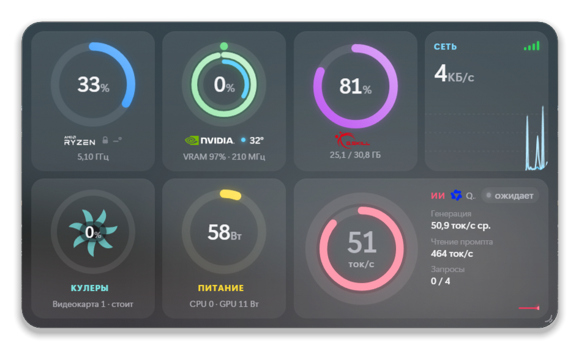
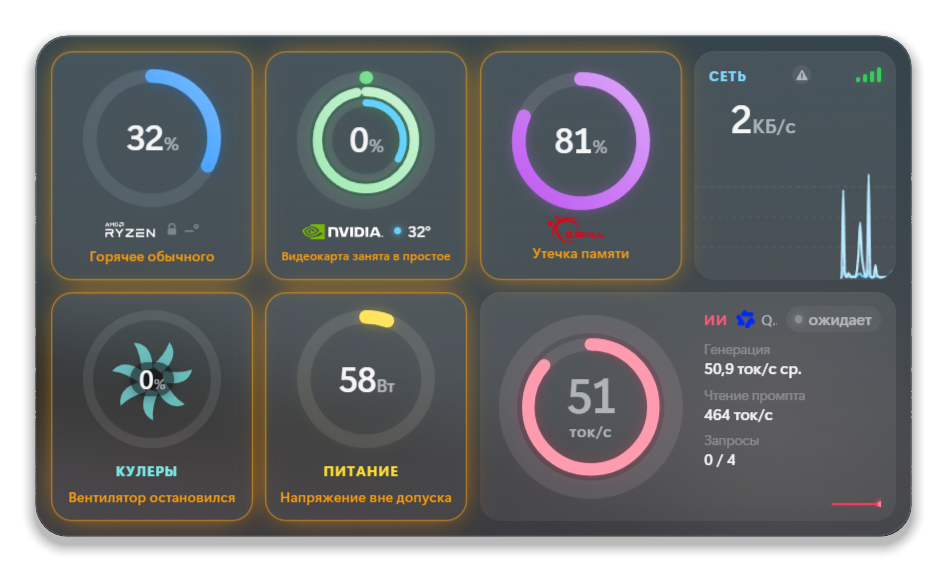
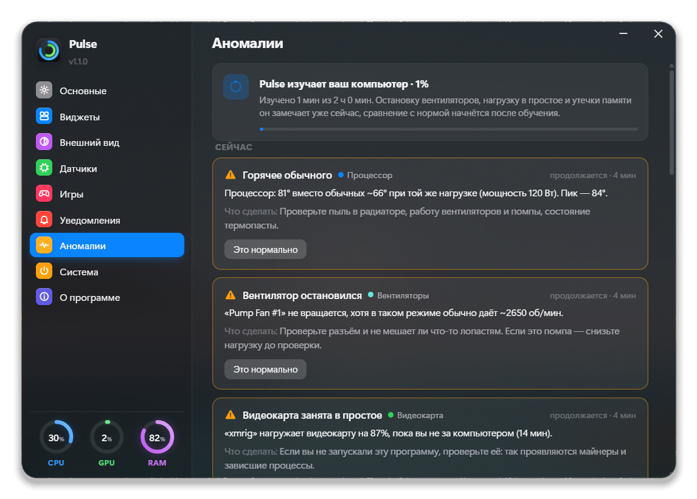
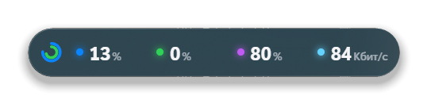
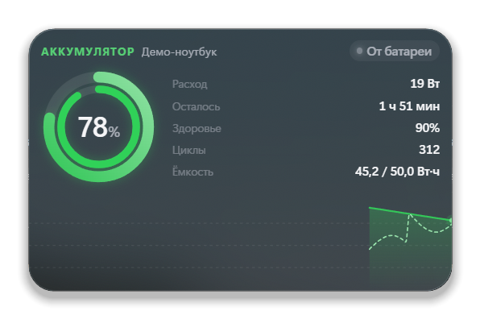
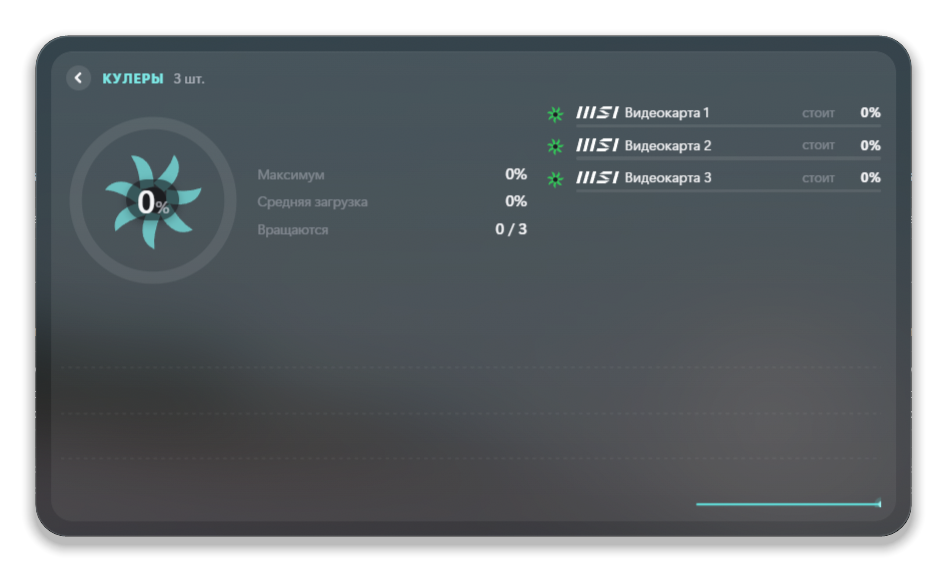
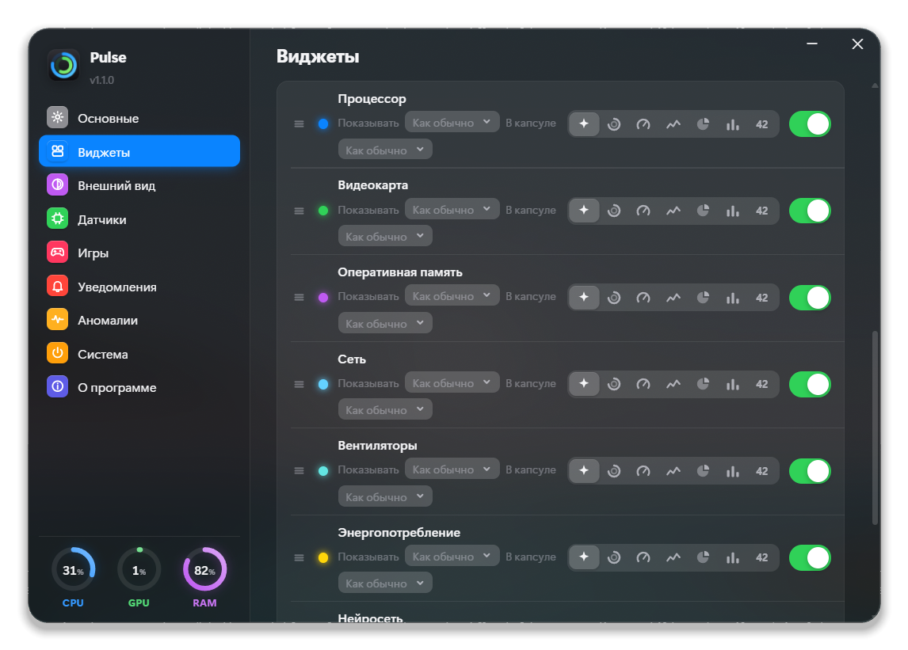
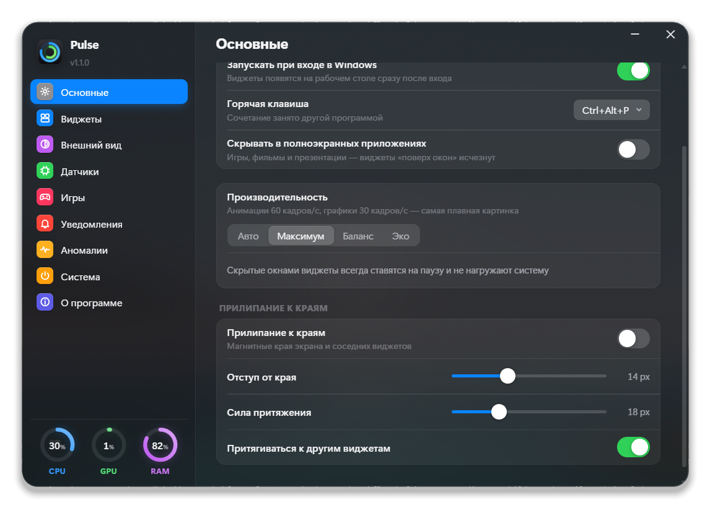
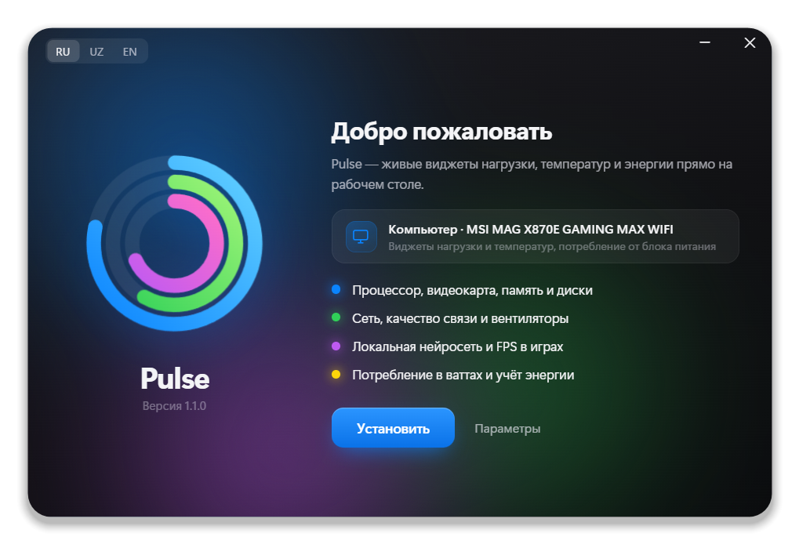

<p align="right"><b>Русский</b> · <a href="README.en.md">English</a></p>

# Pulse

**Живые виджеты нагрузки, температур и энергии прямо на рабочем столе Windows.** Процессор, видеокарта, память, диски, сеть, вентиляторы, блок питания, аккумулятор ноутбука, локальная нейросеть и FPS в играх — в стеклянных виджетах с плавной анимацией, в духе Apple.

<p align="center"></p>

<p align="center"><b><a href="../../releases/latest">⬇ Скачать установщик</a></b> · один файл, Windows 10/11 x64 · русский, oʻzbekcha, English</p>

---

## Возможности

**Что показывает**

- **Процессор** — загрузка по ядрам, температура (в т. ч. каждого CCD), частота, мощность, самые прожорливые процессы.
- **Видеокарта** — NVIDIA, AMD и Intel, включая встроенную графику: загрузка, температура и горячая точка, видеопамять и кто её занимает, частоты, мощность, вентиляторы.
- **Память** — занято/свободно, температура каждой планки DDR5, производитель модулей.
- **Диски** — активность, чтение и запись, температура, свободное место.
- **Сеть** — скорость, ваш провайдер с логотипом и **качество связи до провайдера** индикатором (пинг, джиттер и потери — в подробностях).
- **Вентиляторы и помпа** — обороты и загрузка каждого, вращающиеся роторы, бренд и модель можно подписать.
- **Питание** — сколько берёт компьютер из розетки (CPU + GPU + остальное, с учётом КПД блока питания), стабильность линий +12/+5/+3,3 В, **учёт энергии** за день, неделю, месяц и её стоимость по вашему тарифу.
- **Аккумулятор ноутбука** — заряд, здоровье, циклы, мощность заряда и расхода, время до полного и оставшееся время.
- **Локальная нейросеть** (llama.cpp в Docker) — загруженная модель, скорость генерации ток/с, видеопамять модели, активные запросы.
- **FPS в играх** — небольшое окошко поверх игры: кадры, 1 % low, время кадра, загрузка и температура CPU и GPU (Intel PresentMon).

**Поиск аномалий**

Pulse пару часов изучает, что нормально именно для вашего компьютера, и дальше сообщает об отклонениях: процессор горячее обычного при той же нагрузке, остановился или замедлился вентилятор (или помпа), кто-то грузит процессор или видеокарту, пока вас нет за компьютером (так видны майнеры и зависшие программы), утечки памяти, просадка напряжения блока питания, связь хуже обычного, быстрая разрядка батареи. Обслуживание Windows и ваши Docker-контейнеры отмечаются спокойно, без тревоги. Каждую проверку можно выключить отдельно.

<p align="center"> </p>

## Главные удобства

- **Виджет на рабочем столе или поверх всех окон** — на столе он не мешает, поверх окон всегда на виду; в играх и фильмах на весь экран может прятаться сам.
- **Любой размер с любого края** — плитки сами перестраиваются, текст подгоняется, ничего не обрезается от полоски до большой панели.
- **Магнит** — виджеты прилипают к краям экрана и друг к другу.
- **Свернуть в капсулу** — одна строка с главными цифрами; нажатие разворачивает обратно. Кнопки «свернуть» и «закрыть» в стиле Windows появляются при наведении.
- **Что показывать — решаете вы.** Для каждого модуля: стиль (кольцо, спидометр, график, круговая диаграмма, полосы, цифры) и главный показатель — загрузка, температура, частота, мощность, ГБ, скорость… В капсуле — свой выбор, например «загрузка и температура».
- **Подробности по клику** — плитка разворачивается в подробный вид со списками процессов, дисков, вентиляторов, графиком энергии.
- **Прозрачность колёсиком** — Ctrl + колесо меняет прозрачность фона, Ctrl + Shift + колесо — всего виджета. Есть режим «сквозь клики» и «призрак», который исчезает под курсором.
- **Подсмотр** — Ctrl + Alt + P поднимает все виджеты поверх окон, повторное нажатие — обратно. Ctrl + Alt + F включает и выключает FPS в играх.
- **Несколько виджетов** с общим размером и видом или каждый по-своему.
- **Логотипы производителей** — Intel, AMD Ryzen, NVIDIA, MSI, ASUS, Corsair, Kingston, Samsung, Noctua, be quiet!, Seasonic и всего около 100 брендов встроены и работают без интернета (у редких брендов — аккуратная надпись).
- **Стекло из ваших обоев**, мягкие пружинные анимации, 3D-наклон, тёмная и светлая тема, свои цвета модулей.
- **Три языка** — русский, узбекский (латиница) и английский.
- **Ноутбук или компьютер** — установщик определяет тип и модель устройства; на ноутбуке сразу добавляется виджет аккумулятора, а от батареи Pulse сам переходит в экономный режим.

<table>
<tr>
<td><br><sub>Капсула со свёрнутым виджетом</sub></td>
<td><br><sub>Аккумулятор (демо-данные)</sub></td>
</tr>
<tr>
<td><br><sub>Подробный вид плитки</sub></td>
<td><br><sub>Модули, стили и показатели</sub></td>
</tr>
</table>

## Лёгкий для компьютера

- **Виджеты, закрытые окнами, ставятся на паузу** и почти ничего не потребляют. Это обычное состояние: рабочий стол чаще всего закрыт.
- **Режимы производительности**: «Авто», «Максимум», «Баланс», «Эко». «Авто» обычно держит «Баланс», а на батарее, в режиме экономии заряда, на слабом ПК или под высокой нагрузкой переходит в «Эко» — значения обновляются без анимации, раз в 2 секунды.
- **Сам сбор данных** занимает около 2 % одного ядра; поиск аномалий добавляет около 0,005 мс в секунду.

<p align="center"></p>

## Установка

1. Скачайте `Pulse-Setup-<версия>.exe` со страницы [релизов](../../releases/latest) и запустите.
2. Windows спросит права администратора — Pulse ставится в Program Files, а датчики процессора работают через драйвер [PawnIO](https://pawnio.eu/).
3. Готово: виджет уже на рабочем столе, значок — в области уведомлений.

<p align="center"></p>

**Нужно:** Windows 10 (1903+) или 11, 64 бита; .NET Framework 4.8 (уже есть в Windows); Microsoft Edge WebView2 (есть в Windows 11, на Windows 10 установщик поставит сам).

Установщик не подписан цифровой подписью, поэтому SmartScreen может показать предупреждение — «Подробнее» → «Выполнить в любом случае».

Обновление — запустите новый установщик поверх старого: настройки, расположение виджетов и история энергии сохранятся. Удаление — через «Приложения» Windows, с выбором, оставить ли настройки.

## Конфиденциальность

Всё считается на вашем компьютере, телеметрии нет. В интернет Pulse обращается только:

- к [ipinfo.io](https://ipinfo.io) — узнать название провайдера (выключается в настройках);
- к сайту производителя — за значком бренда, которого нет среди встроенных логотипов;
- при включении датчиков — за драйвером PawnIO (winget или официальный установщик с проверкой SHA-256);
- при установке на Windows 10 без WebView2 — за WebView2 от Microsoft.

## Сборка из исходников

Нужны только Windows, PowerShell и .NET Framework 4.8 — Visual Studio не нужна.

```powershell
.\build.ps1                 # app\Pulse.exe (компилятор C# скачается сам при первой сборке)
.\build-installer.ps1       # dist\Pulse-Setup-<версия>.exe — один файл с программой внутри
```

Версия хранится в `version.txt`. `tools\redeploy.ps1` пересобирает и перезапускает установленную копию, `tools\AnomTest.cs` — офлайн-тесты детектора аномалий.

| Папка | Что внутри |
|---|---|
| `src/` | Программа: датчики (LibreHardwareMonitor), окна WebView2, аномалии, производительность, батарея |
| `ui/` | Интерфейс виджетов и настроек: HTML, CSS, JavaScript, логотипы |
| `setup/` | Установщик (окно на WebView2, установка и удаление) |
| `lib/`, `third_party/` | Библиотеки и PresentMon — см. [THIRD_PARTY_NOTICES.md](THIRD_PARTY_NOTICES.md) |
| `tools/` | Скрипты сборки и разработки |

## Благодарности

[LibreHardwareMonitor](https://github.com/LibreHardwareMonitor/LibreHardwareMonitor) · [PawnIO](https://pawnio.eu/) · [Intel PresentMon](https://github.com/GameTechDev/PresentMon) · [Microsoft Edge WebView2](https://aka.ms/webview) · [Simple Icons](https://simpleicons.org/) · [Wikimedia Commons](https://commons.wikimedia.org/)

